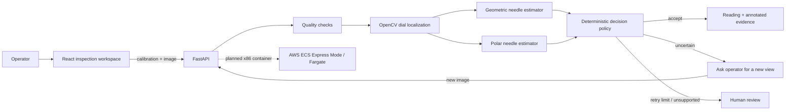

# Qyvoriq

**The vision agent that knows when not to trust its eyes.**

Qyvoriq is a small, evidence-first inspection application for calibrated, circular, single-pointer analog gauges. It combines two OpenCV 5 measurements, checks image quality and dial geometry, and either returns a reading under a stated policy, asks the operator for a new image, or escalates for human review.

> **Prototype.** Qyvoriq is not validated for safety-critical decisions, industrial control, or unattended operation. A `VERIFIED` result means only that the image passed the checks documented below. It does not mean the reading is mathematically certain.

## What works

- OpenCV 5 image quality checks, circular dial localization, radial line analysis, and a polar-coordinate needle estimator.
- User-entered minimum and maximum values, units, angle endpoints, and sweep direction.
- A deterministic agent loop where image quality and estimator agreement change the next tool call.
- Bounded follow-up requests, explicit human escalation, a decision trace, and annotated evidence.
- A FastAPI API and responsive React interface, with upload limits, request IDs, token support, in-process rate limits, and 30-minute in-memory retention.
- Four generated scenarios and a reproducible benchmark harness. Results are explicitly labeled synthetic.

## Current submission status

The local app, OpenCV 5 checks, and evaluation package are implemented. A narrated screen-recording pipeline is available. The final AWS endpoint and public/unlisted judge video are still incomplete until the account owner configures access and the deployed application is recorded. [Connect AWS access](docs/AWS_ACCESS.md) through a dedicated GitHub OIDC role without sharing keys. See [the compliance checklist](docs/HACKATHON_COMPLIANCE.md) and [readiness review](docs/READINESS_REVIEW.md) before submitting.

The live rules require substantive OpenCV 5 use and a meaningful AWS component. The rules header lists **October 26, 2026 at 11:45 p.m. PDT**; the overview body says 11:59 p.m. We use the earlier deadline. [Official rules](https://opencv26.devpost.com/rules) · [Competition overview](https://opencv26.devpost.com/).

## Architecture



The two estimators share grayscale input and the localized center/radius, so their failures are correlated. The agent does not treat agreement by itself as proof. It also checks image quality, geometry, calibration range, and a validation-derived disagreement limit. A contrast-normalized reinspection is attempted only after estimator disagreement. The system never moves a camera or controls equipment.

## Run locally

Requirements: Python 3.12, Node.js 24, and npm.

```bash
python3.12 -m venv .venv
source .venv/bin/activate
python -m pip install -r requirements-dev.txt
npm --prefix frontend ci
PYTHONPATH=. python -m scripts.generate_scenarios
```

Start the API and frontend in separate terminals:

```bash
source .venv/bin/activate
uvicorn backend.api:app --host 127.0.0.1 --port 8000 --reload
```

```bash
npm --prefix frontend run dev
```

Open <http://localhost:5173>. The first inspection can use the **Clear gauge** scenario. For a synthetic perception-action example, select **Glass reflection**; Qyvoriq should request another view and skip needle estimation. The **Clear gauge** fixture shares the same generated dial and 63 psi setting and can be supplied as a controlled synthetic follow-up. This is not a real camera capture.

The runtime readiness endpoint reports the imported `cv2.__version__`. The API returns `ready` only for OpenCV major version 5:

```bash
curl http://127.0.0.1:8000/api/health/ready
```

## Tests and evaluation

```bash
.venv/bin/python -m pytest -q
.venv/bin/ruff check backend benchmarks examples scripts tests
.venv/bin/pip-audit -r requirements.txt
.venv/bin/cfn-lint deploy/*.yaml
NPM_CONFIG_CACHE=/tmp/qyvoriq-npm-cache npm --prefix frontend run build
```

Run a validation split, fit the disagreement threshold from that split, then evaluate on a disjoint test seed range:

```bash
PYTHONPATH=. .venv/bin/python -m benchmarks.run_benchmark --split validation --samples 120 --output benchmarks/results/validation.json
PYTHONPATH=. .venv/bin/python -m benchmarks.calibrate_policy --input benchmarks/results/validation.json
PYTHONPATH=. .venv/bin/python -m benchmarks.run_benchmark --split test --samples 120 --output benchmarks/results/latest.json
PYTHONPATH=. .venv/bin/python -m benchmarks.run_reinspection --samples 30
```

The benchmark reports error as a percentage of full-scale span, tolerance accuracy, coverage, false acceptance, selective risk, runtime, throughput, and failures by synthetic condition. It is a software-behavior check, not real-world validation. SyncG is not bundled or evaluated here; see [evaluation details](docs/EVALUATION.md).

## API

| Method | Path | Purpose |
| --- | --- | --- |
| `GET` | `/api/health/live` | Process liveness |
| `GET` | `/api/health/ready` | OpenCV 5 readiness |
| `POST` | `/api/inspections` | Create an inspection (`file` and JSON `calibration` multipart fields) |
| `GET` | `/api/inspections/{id}` | State and expiry |
| `GET` | `/api/inspections/{id}/result` | Decision, measurements, reasons, and trace |
| `GET` | `/api/inspections/{id}/evidence` | Annotated PNG |
| `POST` | `/api/inspections/{id}/images` | Supply a requested follow-up image |
| `GET` | `/api/benchmarks` | Latest machine-readable benchmark output |

Calibration fields: `minimum_value`, `maximum_value`, `units`, `start_angle_deg`, `end_angle_deg`, and `sweep_direction` (`clockwise` or `counterclockwise`). Image angle 0° points right; positive angles follow image coordinates, clockwise. The conversion handles wraparound and does not clamp out-of-range angles into the valid scale.

If `QYVORIQ_API_TOKEN` is set, API routes require `Authorization: Bearer …`. Production startup refuses to run without this token. Health checks remain public. Public AWS deployments should also place a rate-limiting control such as AWS WAF in front of the ALB.

## Container and AWS

Build and smoke-test the container:

```bash
./scripts/build_container.sh
docker run --rm -p 8080:8080 -e QYVORIQ_ENV=development qyvoriq:local
```

The judge-demo path uses a private ECR image and one x86 ECS Express Mode/Fargate task behind managed HTTPS. Its access bootstrap creates a Secrets Manager token and seven-day application logs; the account needs a default VPC with public subnets. The [AWS access guide](docs/AWS_ACCESS.md) supplies the exact owner setup, then the GitHub workflow can deploy and save live HTTP-check evidence. One steady-state task supports the current in-memory workflow; replacement can lose sessions. A separate advanced ARM64 template remains available. Standard OpenCV 5 is used; **COOL is not claimed**.

See [AWS deployment instructions](deploy/README.md). No AWS resources were provisioned for this workspace. Do not submit a fabricated endpoint as evidence.

## Submission materials

- [Competition compliance](docs/HACKATHON_COMPLIANCE.md)
- [Research and method selection](docs/RESEARCH.md)
- [Technical report](docs/TECHNICAL_REPORT.md)
- [Evaluation methodology and results](docs/EVALUATION.md)
- [Limitations](docs/LIMITATIONS.md)
- [Architecture](docs/ARCHITECTURE.md)
- [Devpost draft](docs/DEVPOST_SUBMISSION.md)
- [Five-minute demo script](docs/DEMO_VIDEO_SCRIPT.md)
- [Security notes](docs/SECURITY.md)

The repository contains generated synthetic gauge images only. No SyncG images or third-party photographs are redistributed. Source code is under the repository MIT license; generated PNG fixtures are CC0-1.0. SyncG is separately licensed CC BY 4.0 if integrated later.
