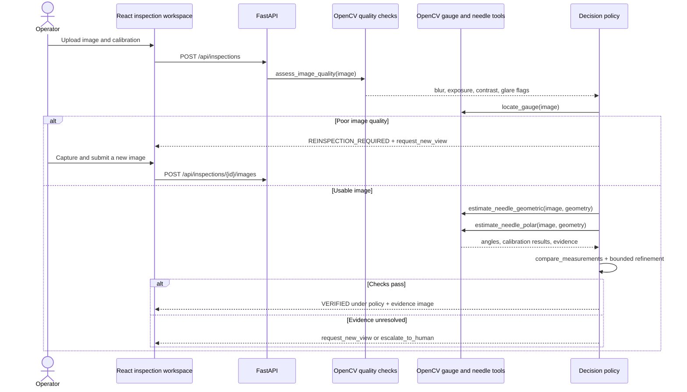
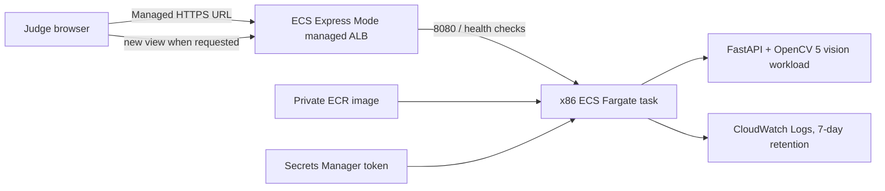

# Architecture

## Implemented local system

The geometric estimator uses radial Hough line segments with a center-origin constraint. The second estimator transforms the dial into polar coordinates and searches for a dark radial response over the annulus. Both share localization and image pre-processing; their outputs are not statistically independent. `compare_measurements` checks disagreement as a percentage of full-scale span, while the policy separately checks quality, geometry, and calibration bounds.

## Runtime services

| Component | Responsibility | State/data |
| --- | --- | --- |
| Vite/React client | Upload, calibration, evidence viewer, trace, benchmark dashboard | Browser session only |
| FastAPI API | Validation, upload bounds, request IDs, status/result/evidence routes | At most 100 records and 128 MiB retained evidence; 30-minute inactivity expiry |
| OpenCV 5 vision modules | Quality signals, circle/contour localization, geometric and polar estimators, annotation | Input limited to 16 MP and normalized to a 1600-pixel long edge; source arrays discarded after analysis |
| Deterministic agent | Select next tool/action, bound retries, accept/reinspect/escalate | Trace appended to inspection record |
| AWS judge-demo design | x86 ECS Express Mode/Fargate, private ECR, managed HTTPS ALB, CloudWatch logs | Access setup prepared; not deployed; one steady-state task; no durable sessions |

## AWS diagram (planned, not deployed)

The primary demo path uses `deploy/express.yaml` with the tested x86 image and a managed HTTPS endpoint. `deploy/bootstrap.yaml` prepares GitHub OIDC access, ECR, the cluster, runtime roles, token secret and seven-day logs. The account needs a default VPC with public subnets. A successful deployment and live smoke-check artifact are still required; a template is not AWS execution evidence. See [AWS access setup](AWS_ACCESS.md).

The task runs standard OpenCV 5 and has no application task role or AWS permission to store inspection data. Multipart parsing may use short-lived OS temporary files; no durable image store is configured. Source arrays are discarded after processing. Retained annotations are bounded by count and PNG byte budget, become inaccessible at 30-minute inactivity expiry, and are purged by a 30-second sweep. One task supports the current process-local workflow; replacement or deployment can lose a session. The original `deploy/service.yaml` remains a separate ARM64 design requiring owner-supplied networking, DNS and certificate. COOL has not been run.

## Tool contracts

| Tool | Input | Output/side effect |
| --- | --- | --- |
| `inspect_image` | decoded BGR image + calibration | starts an observation and trace |
| `assess_image_quality` | decoded BGR image | blur, exposure, contrast, glare measurements; flags are heuristic |
| `locate_gauge` | BGR image | one circle center/radius candidate, or no candidate |
| `estimate_needle_geometric` | image + geometry | Hough radial-line angle or no estimate |
| `estimate_needle_polar` | image + geometry | polar annulus response angle or no estimate |
| `compare_measurements` | two calibrated measurements | disagreement in percent of full-scale span |
| `request_new_view` | quality/disagreement reason | human-facing capture instruction; does not move a camera |
| `reinspect_image` | newly uploaded follow-up image + prior trace | new observation with bounded attempt number |
| `generate_evidence` | original image, geometry, measurements, status | annotated PNG generated from a copy |
| `escalate_to_human` | unresolved reason | explicit human-review action in trace |
