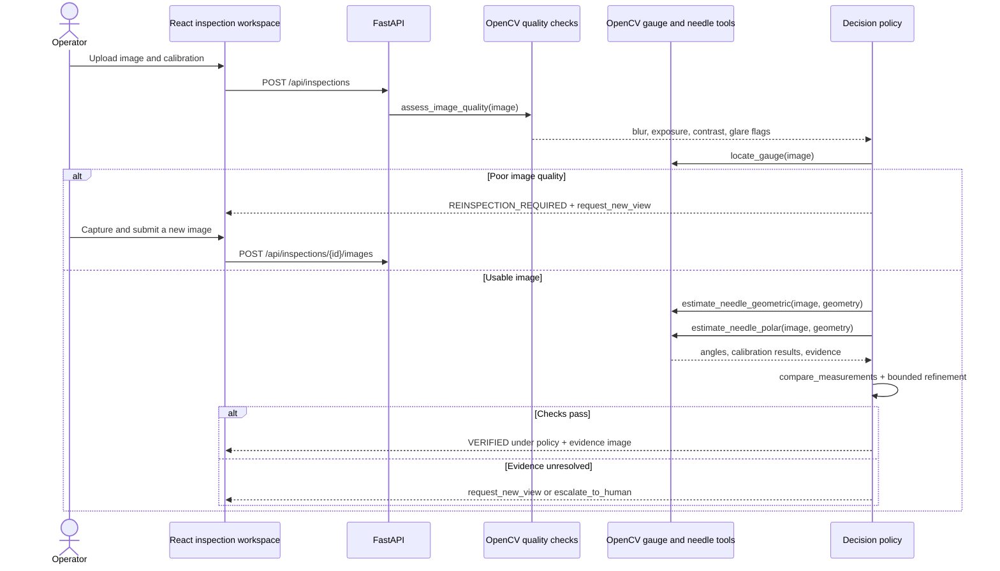
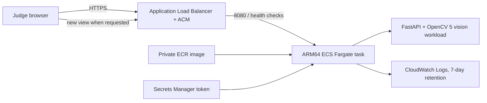

# Architecture

## Implemented local system

The geometric estimator uses radial Hough line segments with a center-origin constraint. The second estimator transforms the dial into polar coordinates and searches for a dark radial response over the annulus. Both share localization and image pre-processing; their outputs are not statistically independent. `compare_measurements` checks disagreement as a percentage of full-scale span, while the policy separately checks quality, geometry, and calibration bounds.

## Runtime services

| Component | Responsibility | State/data |
| --- | --- | --- |
| Vite/React client | Upload, calibration, evidence viewer, trace, benchmark dashboard | Browser session only |
| FastAPI API | Validation, upload bounds, request IDs, status/result/evidence routes | In-memory store; 100 active inspections maximum; 30-minute expiry |
| OpenCV 5 vision modules | Quality signals, circle/contour localization, geometric and polar estimators, annotation | CPU processing; input copy retained only during in-memory session |
| Deterministic agent | Select next tool/action, bound retries, accept/reinspect/escalate | Trace appended to inspection record |
| AWS deployment design | ARM64 ECS Fargate service, private ECR, HTTPS ALB, CloudWatch logs | Not deployed; one task; no durable storage |

## AWS diagram (planned, not deployed)

The deployed container would run the substantive gauge pipeline on Fargate ARM64. It would use standard OpenCV 5 wheels, not COOL. Existing VPC/subnets, certificate, ECR image, and an API token secret are prerequisites. The task has no AWS permissions for inspection data; uploads stay in process memory and are not written to S3 or a database. A single Fargate task is selected to make the in-memory follow-up flow coherent; it is not durable or horizontally scalable.

## Tool contracts

| Tool | Input | Output/side effect |
| --- | --- | --- |
| `inspect_image` | decoded BGR image + calibration | starts an observation and trace |
| `assess_image_quality` | decoded BGR image | blur, exposure, contrast, glare measurements; flags are heuristic |
| `locate_gauge` | BGR image | one circle center/radius candidate, or no candidate |
| `estimate_needle_geometric` | image + geometry | Hough radial-line angle or no estimate |
| `estimate_needle_polar` | image + geometry | polar annulus response angle or no estimate |
| `compare_measurements` | two calibrated measurements | disagreement in percent of full-scale span |
| `request_new_view` | quality/disagreement reason | human-facing capture instruction; does not move a camera |
| `reinspect_image` | newly uploaded follow-up image + prior trace | new observation with bounded attempt number |
| `generate_evidence` | original image, geometry, measurements, status | annotated PNG generated from a copy |
| `escalate_to_human` | unresolved reason | explicit human-review action in trace |
